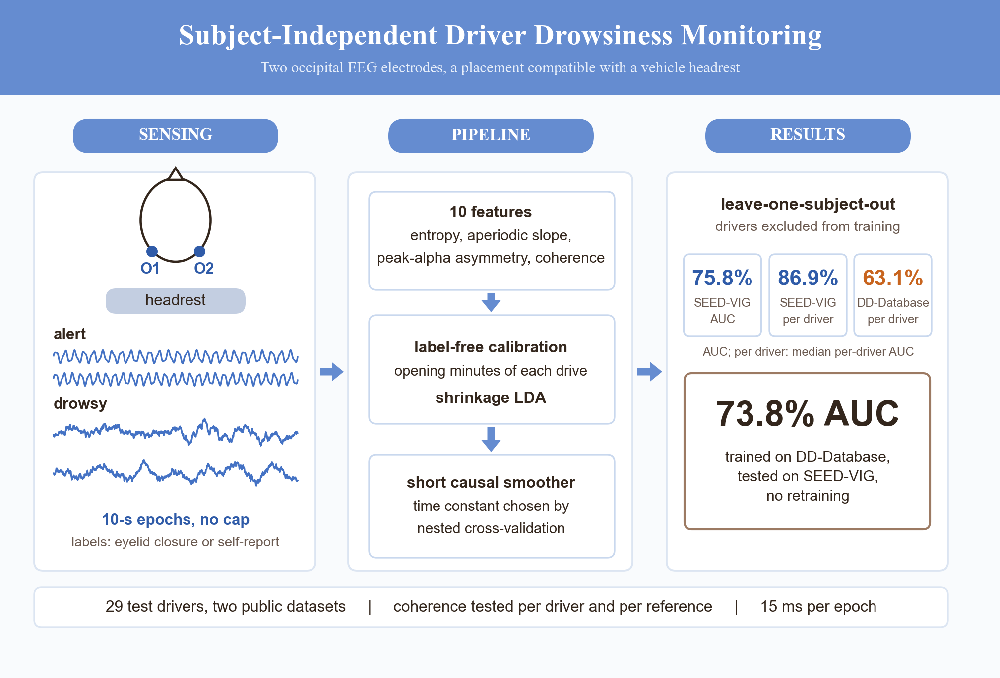

# Subject-Independent Driver Drowsiness Monitoring With an Inter-Hemispheric Occipital EEG Electrode Pair

M. R. Thalassery, S. S. Ali, A. R. Pal, A. Chemori, and G. Murali Mohan

School of Mechanical Engineering, Vellore Institute of Technology (VIT) Chennai, India, and LIRMM, Université de Montpellier, CNRS, France

This repository holds the code and results of the article above, submitted to *IEEE Sensors Journal*. Every result in the article and its supplementary material, whether number, table, or figure, is generated by the scripts here, from the result files in [`results/`](results). The tag [`paper-resubmission-r1`](https://github.com/MuhammedRaslan/Occipital-EEG-Drowsiness-Monitoring/tree/paper-resubmission-r1) marks the version cited in the article.

<p align="center"></p>

## Overview

Two occipital electrodes, O1 and O2, sit where a vehicle headrest meets the head. The article asks how well they recognize drowsiness in drivers who were not part of training.

- **Features.** Ten per 10-s epoch: sample and permutation entropy, aperiodic spectral slope, peak alpha frequency asymmetry, and O1–O2 coherence.
- **Classifier.** A shrinkage linear discriminant, calibrated on each recording's opening window without labels, followed by a causal exponential smoother.
- **Evaluation.** Leave-one-subject-out, reported per driver and per dataset, with driver-level statistics.

## Results

Leave-one-subject-out area under the ROC curve (AUC), in percent:

| Dataset | Labels | Drivers | Pooled AUC | Median per-driver AUC |
|---|---|---|---|---|
| SEED-VIG | eyelid closure (PERCLOS) | 19 | 75.8 | 86.9 |
| DD-Database | drivers' own reports | 10 | 60.0 | 63.1 |

Without the smoother, the pooled and median per-driver AUCs are 72.8 and 78.1 on SEED-VIG, and 60.0 and 59.9 on the DD-Database.

A model trained on the DD-Database ranks SEED-VIG epochs with a pooled AUC of 73.8% without retraining.

Feature extraction takes 15 ms per epoch on a laptop CPU, and the model stores 44 bytes.

The article reports the baselines (EEGNet, Riemannian classifiers), the feature-family ablations, the reference analysis, calibration sensitivity, and transfer in both directions.

## Repository layout

```
analysis/        the analysis steps (00-41), run_all.py, and common.py (shared definitions)
results/         the JSON result file of every step, each recording the commit and time that made it
manuscript/      numbers.tex (every number in the article), the figures, and make_ga.py
supplementary/   numbers.tex, table bodies, and Fig. S1 of the supplementary material
data/            where the datasets go (not included; see data/README.md)
requirements.txt pinned Python dependencies
```

## Data

No EEG data are redistributed. Both datasets are third-party releases with their own terms.

- **DD-Database** (Drivers Drowsiness Database): Orosco et al., Dryad, 2023, [doi:10.5061/dryad.5tb2rbp9c](https://doi.org/10.5061/dryad.5tb2rbp9c), CC0.
- **SEED-VIG**: Zheng and Lu, *J. Neural Eng.*, 14(2), 026017, 2017, [doi:10.1088/1741-2552/aa5a98](https://doi.org/10.1088/1741-2552/aa5a98). Available from the BCMI laboratory, Shanghai Jiao Tong University, under a license agreement.

[`data/README.md`](data/README.md) says where to put each dataset.

## Installation

Python 3.14 on Windows 11 was used for every result; the analyses run on a CPU.

```
pip install -r requirements.txt
```

## Reproducing the results

From the repository root:

```
python -I analysis/run_all.py            # every step, in order
python -I analysis/run_all.py --from 14  # resume at a step
```

Each step is a separate script and writes one JSON file to `results/`. The order is:
- data: SEED-VIG feature cache (00); DD-Database extraction and labels (01–02); SEED-VIG preparation (03);
- results: monitoring and feature families (10); raw-signal baselines (12); per-driver results (13); smoothing sweep (14); coherence at the driver level (15); reference analysis (16); calibration sensitivity (17); cross-dataset transfer (18); ensemble diversity (19);
- further checks: sensitivity analyses (21); duration of labeled states (22); time on task (23); offsets between drivers (24);
- outputs: figures (30); runtime (20); the article's numbers (40); the supplementary tables (41); the graphical abstract.

Built-in checks stop a run if the reproduction drifts:
- step 01 compares feature values with values recorded from the original recordings;
- step 02 checks the label counts;
- step 03 reproduces a previously reported SEED-VIG result.

A full run takes about four hours on an Intel Core i5-10300H laptop processor. Most of that is EEGNet training in step 12.

| Result file | Article |
|---|---|
| `monitoring.json` | Tables III and IV |
| `baselines_dd.json` | EEGNet and Riemannian baselines (Table III) |
| `per_subject.json` | Fig. 3, Fig. S1, and Table S1 |
| `tau_sweep.json` | Fig. 2, Table S5, and the nested time constants |
| `coherence_stats.json` | Fig. 1 and the driver-level coherence tests |
| `reference.json` | Table V and Table S4 |
| `calibration.json` | Table VI (calibration rows) |
| `cross_dataset.json` | Table VI (transfer rows) and Table S8 |
| `ensemble.json` | Table VII |
| `sensitivity.json` | Tables S2, S3, and S6 |
| `label_runs.json` | duration of labeled states, and the SEED-VIG calibration windows |
| `runtime.json` | computational cost, and Section S8 |
| `alarms.json` | time on task (Table S9), and an exploratory alarm analysis that the article does not report |
| `offsets.json` | baselines against the lean-10 LDA per driver, and pooled AUC without driver offsets (Section S7) |
| `dd_extract.json`, `dd_labels.json`, `seed_prepare.json` | epochs, unit checks, and label counts of each dataset |

## Citation

If you use this code, please cite the article. Citation details will be updated on publication. [`CITATION.cff`](CITATION.cff) has the same information in machine-readable form.

```bibtex
@article{thalassery2026occipital,
  author  = {Thalassery, M. R. and Ali, S. S. and Pal, A. R. and Chemori, A. and Murali Mohan, G.},
  title   = {Subject-Independent Driver Drowsiness Monitoring With an Inter-Hemispheric Occipital {EEG} Electrode Pair},
  journal = {IEEE Sensors Journal},
  note    = {Submitted},
  year    = {2026}
}
```

## License

The code is released under the [MIT License](LICENSE). The datasets are not covered by it; each keeps its own terms.

## Contact

Dr. A. R. Pal (corresponding author), School of Mechanical Engineering, VIT Chennai: abhishek.rudrapal@vit.ac.in
